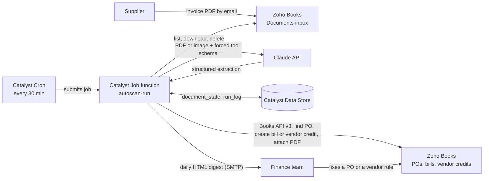
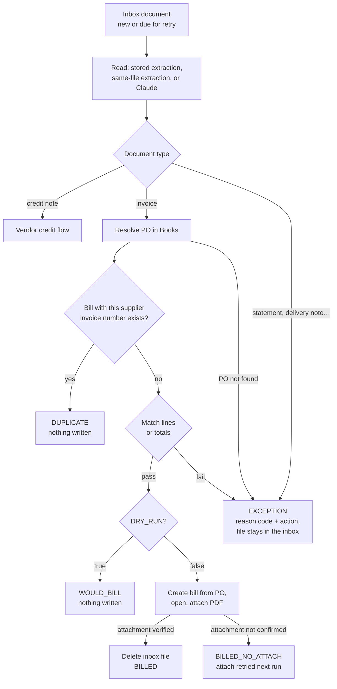

# AutoScan for Zoho Books

Supplier invoices that land in the Zoho Books **Documents inbox** become **bills matched to their purchase orders** — line by line, on deterministic rules, with the PDF attached and every exception explained to the finance team. It runs as a scheduled **Zoho Catalyst** job. **Claude** reads the document; the code decides everything that touches money.


-d97757)

## Why it exists

For every supplier invoice an accounts-payable team repeats the same routine: find the purchase order the supplier quoted, compare quantities, prices and carriage, key the bill, attach the PDF. Suppliers make this harder than it sounds — each prints the PO reference, its item codes and its delivery charges in a different place and format, ships orders in parts, and adds surcharges the PO never mentioned.

The first automation of this routine was a scheduled Deluge function inside Zoho Books. It ran into the limits of that environment: a capped runtime, only the first page of the inbox read, no memory between runs (so the same files were read again and again), silent failures, and bills created at the PO value instead of the value the supplier actually invoiced.

AutoScan is the rebuild: a Node.js job on Zoho Catalyst with its own state, a reconciliation loop, line-level matching, and a daily report that tells finance exactly what was billed and what needs a human.

## What it does

| Capability | Behaviour |
|---|---|
| **Scan** | Every 30 minutes the job lists the Documents inbox (all pages) and picks up files it has never seen, oldest first. PDF, JPG and PNG are supported. |
| **Read** | Each new file goes to Claude once. A forced tool schema returns invoice number, date, PO reference, lines, charges, totals and a confidence score. |
| **Resolve the PO** | Whatever the supplier printed (`PO-00235`, `235`, a legacy `IPO/316037`, a reference buried in free text) is turned into candidates and looked up in Books, cheapest lookup first. |
| **Match** | Phase 1 compares the invoice total with the PO total, or with what is still un-billed on it. Phase 2 matches every invoice line to a PO line by the supplier's code, then checks quantity, price and carriage. |
| **Bill** | A bill is created from the PO with the supplier's invoice number and invoice date, at the **invoice** amounts, opened, and the PDF attached. The inbox file is deleted only after the attachment is verified. |
| **Credit notes** | A supplier credit note becomes a Books vendor credit, applied to the bill it refers to when that bill can be identified. |
| **Reconcile** | A document that could not be billed stays in the inbox with a reason code and is re-checked every 6 hours for a week, using the stored reading — no second AI call. Fix the PO in Books and the bill appears on its own. After a deploy every held document is re-checked on the next run, so a new rule applies at once. |
| **Report** | One HTML digest per day, covering everything since the previous one: bills created (with links into Books), vendor credits, everything waiting for a person grouped by reason with the action to take, duplicates, and the day's AI cost. |

## Architecture



Zoho Books stays the system of record: purchase orders, bills, vendors and the documents themselves never leave it. Catalyst holds only processing state — what has been seen, what was read, what happened — which is what makes retries free and re-uploads harmless. The model is a reader with no authority: its output is validated, recomputed where arithmetic is involved, and passed through the same rules as any other input.

Full detail, including the run sequence and the state machine: [`docs/architecture.md`](docs/architecture.md).

## How one document is processed



Every exception carries a reason code (`PO_NOT_FOUND`, `PRICE_MISMATCH`, `CARRIAGE_MISMATCH`, …), the detail of what was read against what the PO says, and a one-line instruction for finance. The full list with retry behaviour is in [`docs/operations.md`](docs/operations.md#statuses-and-reason-codes).

## Matching rules

**Phase 1 — totals.** The invoice gross must equal the PO total, or the PO's remaining un-billed value, within `TOTAL_TOLERANCE` (default 1.00). The bill is posted at the invoice total; a difference of pence against the PO-priced lines goes into the bill's adjustment.

**Phase 2 — lines** (`PHASE2_ENABLED=true`). The bill carries exactly what the supplier invoiced:

| Check | Rule | On failure |
|---|---|---|
| Line identity | Supplier's code against the PO line's *Supplier Reference* custom field, then the item MPN, SKU, item code. Compared with case, spaces, dots, dashes and slashes removed (`ZK410-KIT` = `ZK410KIT`). | `LINE_UNMATCHED` |
| Items without a code | Matched by value only when exactly one open PO line fits (same unit price, enough quantity, a shared word in the description, no competing invoice line). | `LINE_UNMATCHED` |
| Kits | A kit ordered as one PO line and invoiced as its separate parts is billed as the kit when the parts add up to what is still open on that line, within the price policy. | `LINE_UNMATCHED` |
| Quantity | Not more than ordered minus already billed. Partial deliveries bill what was shipped; a pack on the PO invoiced as single units is recognised, allowing for the price per item rounded to the penny. | `QTY_EXCEEDS` |
| Price | Up to 5 % below the PO price is billed at the invoice price and noted. Any increase goes to review. A product surcharge counts as part of the price. | `PRICE_MISMATCH` |
| Carriage | At or below the PO: accepted and billed as invoiced. Above the PO: decided per vendor by two custom fields finance maintains (*Carriage Rule* Zero / Fixed / Ignore, *Carriage Tolerance*). | `CARRIAGE_MISMATCH` |

Each rule, the business reason behind it and its configuration switch: [`docs/requirements.md`](docs/requirements.md).

## Safety model

The design assumption is that a wrong bill is worse than a late one.

- **The AI reads, the code decides.** No model output reaches Books without passing PO resolution, de-duplication and matching. Sums and date conversion are done in code from the values copied off the page.
- **Dry-run is the default.** `DRY_RUN` is true unless explicitly set to false; a dry run executes the whole pipeline and reports what it would have billed.
- **Nothing is deleted early.** The write order is create bill → open → attach → verify → delete inbox file. A failed attachment leaves the file in place and is retried as attach-only.
- **No double billing.** Duplicates are detected on vendor + supplier invoice number, both against Books and against other documents in the same run (the claim is taken before the first `await`, so parallel workers see it).
- **Idempotent runs.** State is keyed by Books `document_id`; a file hash lets a re-uploaded copy reuse the earlier reading. Re-running a run or crashing mid-run does not create a second bill.
- **No overlapping runs.** A `RUNNING` row in `run_log` blocks a second run until it finishes or goes stale.
- **Production cannot inherit sandbox settings.** One variable set is deployed to both Catalyst environments; the production profile never inherits the organisation id, dry-run flag, go-live cutoff or carriage ids, and refuses to start without its own or against the sandbox organisation.
- **A go-live cutoff protects history.** Documents created before `SCAN_SINCE` are never read, recorded or reported.
- **Bounded work per run.** Caps on new and retried documents, a time budget at 70 % of the function's limit, a rate limiter under the Books per-minute cap, and a clean stop when the Books daily limit is reached.

## Technology choices

**Zoho Catalyst Job function (Node.js 20) on a Cron.** Chosen for the 15-minute execution window, first-class environment variables, a managed data store, and because it runs inside the organisation's own Zoho account and data centre. It replaces a Deluge scheduled function whose runtime caps and lack of state were the root of the original problems. Trade-offs accepted: job logs arrive with a delay of a few minutes, the Console cannot pass parameters when submitting a job by hand, and promotion to Production is a Console action rather than a CLI one.

**Claude (Haiku class) with a forced tool schema.** Supplier layouts differ too much for fixed parsing rules, so one prompt and one JSON schema cover every supplier. `tool_choice` forces the schema, so there is no free text to parse and no retry for malformed output; the system prompt is cached, so documents processed back to back in a run pay a fraction of the input price. A stronger model is a configuration switch (`CLAUDE_FALLBACK_MODEL`), off by default — the cheapest capable model reads the reference document set correctly. Trade-off: a language model can misread or miscalculate, which is why arithmetic and dates are recomputed in code and why a truncated answer is an error rather than an empty reading.

**Catalyst Data Store for processing state.** Two tables, `document_state` and `run_log`. The alternative — moving files between folders in Books to mark progress — has no documented API, and gives nowhere to keep the reading for a free retry. Trade-offs: ZCQL column and text-size limits shape the adapter, and row ids exceed JavaScript's safe integer range (see *Engineering notes*).

**Zoho Books API v3 through a Self Client refresh token.** The scope is `ZohoBooks.fullaccess.all` because the Documents endpoints have no granular scope; least privilege is enforced through the Books role of the user who authorises the client.

**SMTP (nodemailer) for the digest.** Catalyst Mail requires a verified sender or domain; SMTP from a mailbox the organisation already owns needs no DNS change. Catalyst Mail remains available as a transport, and `log` writes the report to the function log when no mailbox exists yet.

**Plain CommonJS, no build step, `node:test`.** Catalyst deploys the function folder as it is. The matching logic is written as pure functions, so the whole pipeline is tested with in-memory fakes and no test framework dependency. Trade-off: no static types.

## Cost and limits

| Resource | Usage | Basis |
|---|---|---|
| Claude | About $0.001 per document on a Haiku-class model; retries and re-uploads cost nothing | Measured on sandbox runs |
| Zoho Books API | Roughly 9–10 calls per billed invoice, 4–6 per exception | Design estimate, see `docs/architecture.md` |
| Books rate limit | Token bucket at 80 calls/min (organisation cap 100), concurrency 3 | `BOOKS_RATE_PER_MIN`, `CONCURRENCY` |
| Catalyst execution | Up to 40 new + 20 retried documents per run, stopping at 70 % of the job's time limit | `MAX_NEW_PER_RUN`, `MAX_RETRY_PER_RUN`, `TIME_BUDGET_RATIO` |

## Getting started

Prerequisites: Node.js 20 or later; a Zoho Books organisation with a **sandbox** and permission to create a Self Client; an Anthropic API key; the Catalyst CLI only when you deploy.

```bash
git clone <repository-url> autoscan && cd autoscan
npm install              # root tooling; postinstall installs the function's own dependencies
cp .env.example .env     # every variable is described in docs/configuration.md
```

1. **Books token.** In the Zoho API console create a Self Client, generate a grant code with scope `ZohoBooks.fullaccess.all`, put `BOOKS_CLIENT_ID` and `BOOKS_CLIENT_SECRET` in `.env`, then:
   ```bash
   npm run token -- <grant-code>     # prints BOOKS_REFRESH_TOKEN for .env
   ```
2. **Pick the sandbox organisation.** Set both `BOOKS_ORG_ID` and `SEED_ALLOW_ORG_ID` to it:
   ```bash
   npm run probe -- orgs             # lists organisations, sandboxes included
   npm run probe                     # confirms payment terms, inbox count, a few POs
   ```
3. **Claude key.** Set `ANTHROPIC_API_KEY` and `CLAUDE_MODEL`, then verify with one minimal call:
   ```bash
   npm run claude-check
   ```
4. **Seed the sandbox** with vendors, items and one purchase order per test scenario. In the Books UI, create the vendor custom fields *Carriage Rule* (dropdown: Zero, Fixed, Ignore) and *Carriage Tolerance* (decimal) and the item custom field *Supplier Reference* first.
   ```bash
   npm run seed -- --plan            # prints the plan, touches nothing
   npm run seed
   ```
5. **Generate synthetic supplier invoices** and upload the PDFs to the sandbox Documents inbox:
   ```bash
   npm run invoices                  # seed/invoices/*.pdf + manifest.json with the expected outcome per file
   ```
6. **Run one cycle** from your machine:
   ```bash
   npm run run                       # dry-run: nothing is written to Books, the report lands in out/
   npm run run -- --live             # writes to Books; also requires DRY_RUN=false in .env
   ```
   A second run reads nothing again: known documents are skipped, exceptions wait for their retry window (`npm run run -- --retry-now` re-checks them immediately, without an AI call).

## Tests

```bash
npm test
```

The suite runs on `node:test` with in-memory fakes for Books, Claude and the state store — no network, no credentials. It ends with `# fail 0`. It covers the queue (new documents before retries, exceptions never re-read), dry-run writing nothing, duplicate detection across Books and within a run, bills posted at the invoice total, credit notes, the daily digest firing once per local day and covering everything since the previous one, the retry window with its slack and the one-shot re-check after a deploy, recovery from a dead run, the environment profiles, and the line matcher in isolation: codes, partial deliveries, the price policy, pack against each with per-item rounding, kits invoiced as their parts, carriage at, below and above the PO under each vendor rule, surcharges inside and on top of the PO price, and every way the value fallback must refuse.

Two further tools exercise the reader and the matcher on real documents without committing them: `npm run golden` reads a local, git-ignored folder with the extractor only, and `npm run replicate` rebuilds the purchase orders behind those documents in the sandbox. See [`docs/operations.md`](docs/operations.md#testing-a-new-batch-of-real-documents).

## Deployment

```bash
npm run deploy     # builds functions/autoscan-run/catalyst-config.json from .env, then catalyst deploy --only functions
```

The one-time setup — CLI login, linking the repository to a Catalyst project, the two Data Store tables, the job pool and cron, the report mailbox, and promotion to Production — is in [`docs/catalyst-setup.md`](docs/catalyst-setup.md).

> [!WARNING]
> `catalyst deploy` replaces the function's environment variables with the contents of `catalyst-config.json`. That file is generated from `.env`, carries real secrets, and is git-ignored. Never commit it, and never set variables by hand in the Console expecting them to survive a deploy.

## Project structure

```text
functions/autoscan-run/        The deployable Catalyst Job function
  src/index.js                 Entry point: picks the environment profile, wires dependencies
  src/config.js                Every tunable, read from environment variables — no literals elsewhere
  src/pipeline/                run.js (lock → scan → new → retries → report), processDocument.js,
                               resolvePo.js, match.js (totals), lines.js (line matcher, pure),
                               vendorRules.js, bill.js, creditNote.js, reasons.js
  src/books/                   Books v3 client (rate-limited, retried) and OAuth token refresh
  src/claude/                  Extractor, tool schema, the prompt
  src/state/                   Store interface: Catalyst Data Store in production, JSON file locally
  src/report/                  Per-run report, daily digest, mail transports
  src/util/                    Rate limiter, MIME detection, money, hashing
  test/                        node:test suites backed by fakes
scripts/                       Local tooling: token, probe, seed, synthetic invoices, local run,
                               golden set, replicate, deploy, mail test
docs/                          Architecture, business rules, decisions, setup, configuration, operations
```

Business rules belong in `src/pipeline/` as pure functions with a test; anything that talks to Books goes through `src/books/client.js`; nothing outside `src/config.js` reads `process.env`.

## Engineering notes

Decisions and discoveries that shaped the code. Each is recorded with its reasoning in [`docs/decisions.md`](docs/decisions.md).

- **The model copies, the code computes.** On real documents the reader once added two charges incorrectly and once wrote a day-first date month-first. Charges are now returned one by one and summed in code; the date is also returned exactly as printed and converted in code. The model's own totals are only a fallback.
- **A truncated answer is an error.** A long invoice that hits the output-token cap parses into an empty extraction with zero lines. That is now a hard failure with a clear message instead of a silent "nothing found".
- **Prompt changes re-read only what they could fix.** The prompt version is a hash of the rendered prompt and is stored with each reading. After a prompt change, only documents parked for a reason a misreading could cause are read again, once. Code changes need no re-read — they apply to the stored reading on the next retry.
- **Row ids beyond 2^53.** Catalyst Data Store ROWIDs are 17 digits and arrive in REST responses as JSON numbers, so `JSON.parse` rounds them and a later update hits the wrong row or none. Ids are re-read through ZCQL after every insert and every update response is verified.
- **Partial updates keep stale columns.** A billed row used to keep the reason of its last failed attempt, because an update leaves absent columns untouched. Reason fields are written as empty strings on a clean outcome.
- **Fields are found by label, not API name.** Custom fields in a Books sandbox carry a different API name from the same field in production, so vendor rules and the supplier reference are resolved by their label.
- **Special payment terms come back as zero days.** Books returns a term such as "due end of next month" on a PO as 0 days plus a label; sending 0 would make the bill due on receipt. The term is resolved by label when the pair does not match.
- **Jobs log to stdout only.** Catalyst does not show stderr for job functions, so every level goes to stdout as one structured line with the run id, and secrets are redacted by key name.

## Known limitations

- One Books organisation per deployment, and one currency: tolerances are plain amounts and the defaults (VAT handling, `Europe/London` report time zone) assume a UK organisation.
- The Books Documents endpoints are not part of Zoho's published API reference; the client uses the request shapes observed to work and would need attention if Zoho changes them.
- Documents longer than `CLAUDE_PAGE_CAP` pages (default 6) are not read and go to manual handling.
- Line matching depends on item data: a PO whose lines carry no supplier code falls back to the total match, and the value fallback deliberately refuses anything ambiguous.
- The daily digest is sent by the first run after `DAILY_REPORT_HOUR`, so the cron must still fire after that hour.
- The per-model price table used for the cost estimate in reports is maintained by hand in `src/claude/extractor.js`.
- There is no CI pipeline yet; the tests run locally before each deploy.
- Documents created before the go-live cutoff are ignored by design; processing a historical backlog is not implemented.

## Documentation

| Document | Answers |
|---|---|
| [`docs/architecture.md`](docs/architecture.md) | How the pieces fit, the run sequence, the document state machine, what must not be changed casually |
| [`docs/requirements.md`](docs/requirements.md) | The business rules the matcher implements and why |
| [`docs/decisions.md`](docs/decisions.md) | Every significant design decision with its reasoning |
| [`docs/configuration.md`](docs/configuration.md) | Every environment variable: purpose, default, production behaviour |
| [`docs/catalyst-setup.md`](docs/catalyst-setup.md) | One-time Catalyst setup, deployment, promotion to Production |
| [`docs/operations.md`](docs/operations.md) | Reading the logs, reason codes, troubleshooting, testing new documents |

New to the code base: read this page, then `architecture.md`, then `requirements.md`; run the *Getting started* steps against a sandbox before touching `src/pipeline/`.
