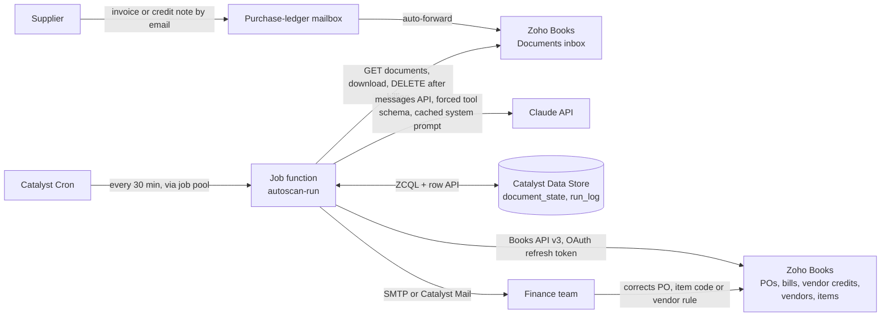
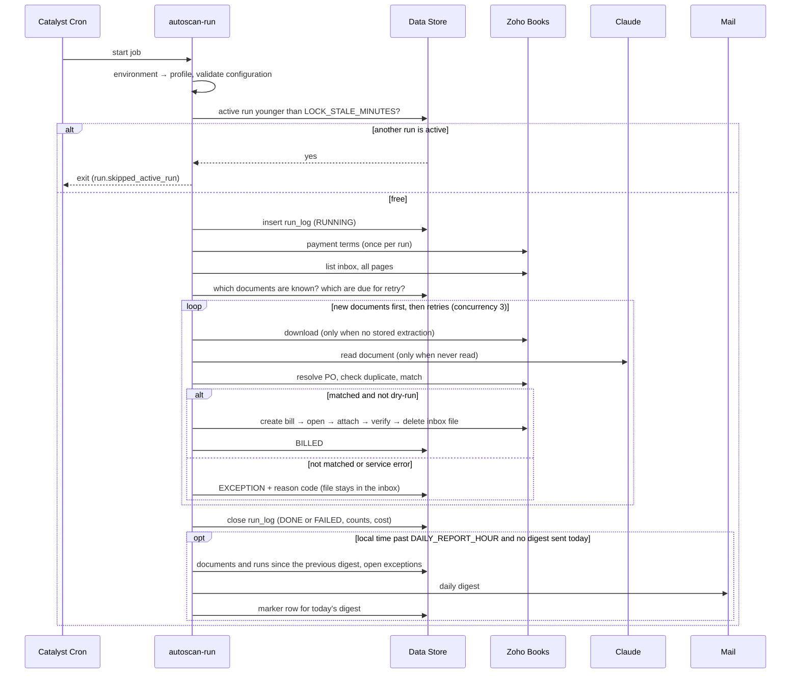
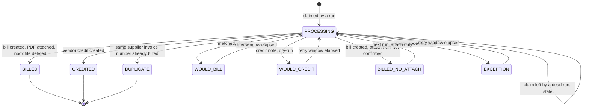

# Architecture

How AutoScan is put together, why it is shaped this way, and what must not be changed casually. For the business rules the matcher implements see [`requirements.md`](requirements.md); for the reasoning behind individual choices see [`decisions.md`](decisions.md).

## 1. System map

| Component | Responsibility | Source of truth for |
|---|---|---|
| **Zoho Books** | Holds the documents, purchase orders, bills, vendor credits, vendors, items and payment terms. | All business data. AutoScan reads the inbox and writes bills and vendor credits; nothing else. |
| **Catalyst Job function `autoscan-run`** | Orchestrates one run: lock, scan, process, report. Node.js 20, type `job`. | Nothing durable — it is stateless between runs. |
| **Catalyst Data Store** | `document_state` (one row per inbox document) and `run_log` (one row per run, plus one marker row per daily digest). | Processing state: what was seen, what was read, the outcome, the attempt count. |
| **Claude API** | Reads one PDF or image and returns one structured extraction. | Nothing. It takes no decision. |
| **Mail transport** | Delivers the daily digest. | — |

There is no user interface. Finance works in Zoho Books and reads one email a day; correcting the PO, the item's supplier code or the vendor's carriage rule in Books *is* the retry button.

## 2. Why this shape

- **Polling a queue, not reacting to events.** Books does not emit an event when a document reaches the inbox, so the job polls. A 30-minute cadence is far inside what finance needs and keeps empty runs negligible (a few queries, no AI call).
- **State outside Books.** The inbox itself is the queue; a document stays there until it is billed. Progress is recorded in Catalyst rather than by moving files between Books folders, because there is no documented API for that and because the stored reading is what makes every retry free.
- **Read once, decide many times.** Reading is the only step that costs money and the only non-deterministic one. Its result is stored, so matching can be repeated for a week — after a PO is fixed, after a rule changes, after a code change — without calling the model again.
- **One function, not several.** A run is short, sequential in its phases and bounded by caps, so a single job with internal concurrency of 3 is simpler to reason about than a fan-out, and one lock is enough to prevent overlap.

## 3. Run lifecycle

Details that matter when reading the code (`src/pipeline/run.js`):

- **New before old.** New documents are always processed before retries, so a backlog of exceptions can never starve fresh invoices. Retries run only if the time budget allows.
- **Bounded.** `MAX_NEW_PER_RUN` (40) and `MAX_RETRY_PER_RUN` (20) cap the work; the run stops taking documents at `TIME_BUDGET_RATIO` (70 %) of the function's maximum execution time. Whatever is left is picked up by the next run.
- **Daily limit.** A Books daily-limit response stops the run cleanly; unprocessed documents stay untouched.
- **A failed digest never fails the run**, and the marker row is written only after a successful send, so the next run tries again.

## 4. Document lifecycle

- `BILLED`, `CREDITED` and `DUPLICATE` are terminal. Everything else is open and appears under "needs attention" in the daily digest.
- **Retry windows.** Open documents are re-evaluated every `RETRY_AFTER_HOURS` (6) less `RETRY_SLACK_MINUTES` (5), up to `MAX_ATTEMPTS` (28) — one week. The slack exists because a run starts a few seconds after its cron slot: without it a document checked at 13:30:03 is two seconds short of six hours at 19:30:01 and, with a cron that stops in the evening, waits until the next morning. Service errors (`AI_ERROR`, `BOOKS_ERROR`, `ATTACH_FAILED`) are retried on the next run. A `PROCESSING` claim older than `LOCK_STALE_MINUTES` belongs to a run that died and is retried as well.
- **Re-check after a deploy.** `RECHECK_HELD_BEFORE` is stamped with the deploy time; every open document last checked before it is re-checked on the next run (still capped by `MAX_RETRY_PER_RUN`, oldest first). Once checked it is past the stamp, so the re-check happens once.
- **`WOULD_BILL` is retry-eligible on purpose**: the first live run after a dry-run period bills what the dry runs matched.
- A document that leaves the inbox (billed by hand, deleted) simply stops being a candidate; its row remains as history.

## 5. Per-document pipeline

`src/pipeline/processDocument.js` handles one document end to end and never throws: every outcome becomes a state row and a report line.

| Step | What happens | Books calls | AI calls |
|---|---|---|---|
| **Claim** | The row is written as `PROCESSING` with this run's id before any work. | 0 | 0 |
| **Read** | Use the stored extraction; else download the file, detect the type from its first bytes, hash it, and reuse the extraction of an identical file; else send it to Claude. Unsupported types and documents over the page cap stop here. | 0–1 | 0–1 |
| **Classify** | Credit notes branch to `creditNote.js`. Statements, delivery notes and the like stop as `NOT_AN_INVOICE`. No PO reference or low confidence stop here too. | 0 | 0 |
| **Resolve PO** | `resolvePo.js` builds candidates from the printed reference and tries them against `purchaseorder_number`, then `reference_number`. | 2–4 | 0 |
| **De-duplicate** | Vendor + supplier invoice number, against Books and against documents already claimed in this run. | 1 | 0 |
| **Match** | Phase 2 (`lines.js`) when enabled and the PO lines carry codes; otherwise Phase 1 (`match.js`). The vendor's carriage rule, and the item record of any PO line without a *Supplier Reference*, are fetched once per run and cached. | 1–2 + uncached items | 0 |
| **Bill** | Bill template from the PO → whitelisted payload → create → ensure open → attach → verify → delete the inbox file. | 4–5 | 0 |

The call counts are design estimates: roughly 9–10 Books calls for a billed invoice and 4–6 for an exception.

### Resolving the PO

Suppliers print the customer's PO reference in many shapes. `candidatesFor()` expands the printed value into the plausible Books values — the raw text, the configured prefix plus digits, the zero-padded form, legacy prefixes (`PO_LEGACY_PREFIXES`), and the bare number — and `resolvePurchaseOrder()` tries them in order of likelihood so that most invoices cost a single search. An exact `purchaseorder_number` wins; then an exact `reference_number`; then a single partial hit on `reference_number`. The numbering format is configuration (`PO_PREFIX`, `PO_PAD_WIDTH`), and is also rendered into the prompt so the model knows what a genuine PO reference looks like.

### Matching

Both matchers are pure functions with no I/O.

- **Phase 1 (`match.js`)** — invoice gross against the PO total within `TOTAL_TOLERANCE`, with a second chance against the PO's remaining value (PO total minus the bills already linked to it).
- **Phase 2 (`lines.js`)** — each invoice line to one PO line by supplier code (or by value, or — for a kit invoiced as its parts — several invoice lines to the kit line), then quantity against what is still un-billed, price against the PO within the price policy, carriage against the open carriage line and the vendor rule, and finally the recomputed total against the invoice total. All lines must pass or the whole document is an exception with per-line detail. A PO with no coded lines falls back to Phase 1 and the report says so.

The rules themselves are specified in [`requirements.md`](requirements.md).

### Creating the bill

`bill.js` never builds a bill from scratch. It asks Books for the bill template of the PO (`bills/editpage/frompurchaseorders`), which carries the right vendor, accounts, taxes and line links, then sends back a whitelisted subset with the supplier's invoice number, the invoice date, the payment terms of the PO, and — in Phase 2 — the invoiced quantities and prices. Two safety nets: if the template's total disagrees with the invoice in Phase 1 the document stops as `BILL_TEMPLATE_MISMATCH`; and if the created bill's total differs from the invoice, the bill is flagged in the report rather than silently accepted.

### Credit notes

`creditNote.js` resolves the PO with the same resolver, de-duplicates on vendor + credit note number, maps the credited lines to PO lines, creates the vendor credit as a draft, verifies that Books priced it at the printed total (the draft is deleted otherwise), opens it, applies it to the related bill when one can be identified — by the invoice number printed on the note, or the PO's only bill — attaches the PDF and deletes the inbox file. A credit that could not be linked to a bill is called out in the report.

## 6. Module boundaries

| Module | Owns | Must never |
|---|---|---|
| `src/config.js` | Every tunable and the environment profiles. | Be bypassed: no other file reads `process.env` for behaviour. |
| `src/books/client.js` | All HTTP to Books: rate limiting, retries, error classification. | Contain business rules. |
| `src/claude/` | The prompt, the tool schema, normalisation of the model's answer, cost estimation. | Decide outcomes. It returns a reading; it does not judge it. |
| `src/pipeline/lines.js`, `match.js` | Matching decisions, as pure functions. | Perform I/O. Purity is what makes them testable and replayable offline. |
| `src/pipeline/processDocument.js` | The order of steps and the mapping from failures to reason codes. | Throw. One bad document must not stop the run. |
| `src/pipeline/reasons.js` | The reason codes and the instruction finance sees for each. | Be duplicated elsewhere; reports and state reference the codes defined here. |
| `src/state/store.js` | The store interface and its two implementations (Data Store, JSON file). | Leak ZCQL or row ids to callers. |
| `src/report/` | Turning rows into HTML and text; choosing the transport. | Query Books or change state, apart from the digest marker. |

## 7. State model

Two tables; the exact columns and types are listed once, in [`catalyst-setup.md`](catalyst-setup.md#3-data-store-tables).

- **`document_state`** — keyed by the Books `document_id`. Holds the file hash, status, reason, attempt counters and timestamps, the ids and numbers of the PO, bill or vendor credit, the extraction as JSON, the prompt version and model that produced it, and token counts. On a billed row the reason text carries the billing notes shown in the digest.
- **`run_log`** — one row per run with counts, API and token usage and estimated cost, plus one marker row (`daily_YYYY-MM-DD`) per digest sent.

Queries are run-level — "which of these ids are known", "what is due for retry" — never a lookup per document inside a loop.

## 8. Environment profiles

The same code and the same variable set are deployed to both Catalyst environments. The function reads the environment name from the invocation (`x-zc-environment`) and picks a profile:

| Catalyst environment | Profile | Variables |
|---|---|---|
| Development | `sandbox` | The plain variables; `BOOKS_ORG_ID` is the sandbox organisation. |
| Production | `production` | `PROD_<NAME>` when set, otherwise `<NAME>`. |

Six variables are never inherited by the production profile — `BOOKS_ORG_ID`, `BOOKS_APP_BASE`, `DRY_RUN`, `SCAN_SINCE`, `CARRIAGE_ITEM_ID`, `CARRIAGE_ACCOUNT_ID` — because they are either identifiers that belong to one organisation or switches that must be set deliberately. Without its own values the production profile refuses to start, or stays in dry-run; it also refuses to start if its organisation id equals the sandbox one. The first log line of every run (`job.profile`) states the profile, the organisation and the dry-run flag.

The profile is derived from the environment rather than from a variable because a variable would be identical in both environments.

## 9. Reliability

| Failure | Mechanism |
|---|---|
| Two runs overlap | `RUNNING` row in `run_log`; a second run exits unless the first is older than `LOCK_STALE_MINUTES`. |
| A run dies mid-document | The `PROCESSING` claim goes stale and the document is retried. De-duplication prevents a second bill if the first one was created. |
| Books returns 429 or 5xx, or the network fails | Retried with exponential backoff and jitter inside the client; persistent failure becomes `BOOKS_ERROR`, retried next run. |
| Books daily limit reached | Dedicated error; the run stops, the rest waits for the next run. |
| Claude is overloaded or times out | SDK retries, then `AI_ERROR`, retried next run. |
| Claude's answer is truncated | Treated as an error (`AI_ERROR`) instead of an empty reading. |
| Attachment upload fails after the bill exists | `BILLED_NO_ATTACH`; the next run attaches only. The inbox file is kept until then. |
| The same file is uploaded twice | Same hash → the stored reading is reused; same invoice number → `DUPLICATE`. |
| Two copies of one invoice arrive in the same batch | In-run claim on vendor + invoice number, taken synchronously before the first await. |
| A Data Store write is lost or hits the wrong row | Row ids are re-read through ZCQL after insert; update responses are verified; transient store errors are retried with backoff. |

## 10. Security and data handling

- **Secrets** live in `.env` locally and in the function's environment variables on Catalyst. They reach Catalyst inside `catalyst-config.json`, which is generated at deploy time and git-ignored. Nothing secret is committed, and the logger redacts values by key name (tokens, secrets, passwords, API keys).
- **Books access** uses a Self Client refresh token with scope `ZohoBooks.fullaccess.all`. The scope is broad because the Documents endpoints have no narrower one; what the integration can do is limited by the Books role of the user who authorised the client. Use a dedicated integration user with the minimum role that can read documents and purchase orders and create bills and vendor credits.
- **What leaves Zoho.** The document itself is sent to the Claude API for reading; nothing else is. The extraction is stored in the Data Store of the same Catalyst project. Supplier documents contain business data and occasionally names and contact details of individuals; no additional personal data is collected.
- **Real documents never enter the repository.** Sample documents used for tuning live in git-ignored folders, and the tooling that snapshots purchase orders for testing leaves out addresses, contact persons and bank details.
- **No inbound surface.** The function is triggered only by Catalyst's scheduler; it exposes no HTTP endpoint and receives no webhooks.
- **Write guards.** Local scripts that write to Books refuse to run unless `BOOKS_ORG_ID` equals `SEED_ALLOW_ORG_ID`, and the read-only tooling enforces GET-only at the transport.

## 11. Assumptions and what breaks without them

| Assumption | If it stops holding |
|---|---|
| Supplier documents are forwarded into the Books Documents inbox. | Nothing is processed; the job has no other input. |
| Suppliers print the customer's PO reference on the invoice. | Documents stop as `NO_PO_REF` and need manual handling. |
| Carriage is a line item on the PO (Books POs have no shipping field). | Carriage comparison finds no PO carriage; invoiced carriage is then governed entirely by the vendor rule. |
| Items carry the supplier's code (*Supplier Reference* or MPN). | Phase 2 falls back to value matching for single lines, or to totals for the whole PO. |
| One organisation and one currency per deployment. | Tolerances and totals would compare amounts in different currencies. |
| The cron fires at least once after `DAILY_REPORT_HOUR`. | That day's digest is not sent; the next one covers both days. |
| The Books Documents endpoints keep their current request shapes. | Scan, download or delete fail; see `src/books/client.js`. |

## 12. Danger zones

> [!WARNING]
> These are the places where a small change has a large blast radius.

- **`DRY_RUN` / `PROD_DRY_RUN`.** Setting it to false is the moment bills start being created. Do it once, deliberately, after sign-off.
- **`SCAN_SINCE` / `PROD_SCAN_SINCE`.** Removing or moving it back makes every older document in the inbox eligible, oldest first.
- **The write order in `bill.js` and `processDocument.js`.** Deleting the inbox file before the attachment is verified loses the only copy of the document.
- **The prompt (`src/claude/prompt.v7.md`).** Any edit changes the prompt version and triggers one re-read of every document parked for a reading or matching reason. Run the golden set before deploying a prompt change.
- **Row ids in `src/state/store.js`.** Never take a ROWID from an insert or update response; it has been rounded.
- **Data Store column names.** They are case-sensitive and must match `DOCUMENT_FIELDS` / the run fields exactly; a new column must be created in both environments before the code that writes it is deployed.
- **`catalyst-config.json`.** Deploying replaces all function variables with its contents. Anything set by hand in the Console is lost.

## 13. Extending safely

- **A new matching rule** → `src/pipeline/lines.js`, as a pure function, behind a configuration switch in `src/config.js` that defaults to the existing behaviour, with a test in `test/lines.test.js` and a scenario in `scripts/seed-sandbox.js`. Record the rule in `requirements.md` and the reasoning in `decisions.md`.
- **A new reason code** → `src/pipeline/reasons.js` with the instruction finance should see. If a misreading could cause it, add it to `EXTRACTION_REASONS` in `processDocument.js`.
- **A new Books call** → a method on the client in `src/books/client.js`, so it inherits rate limiting, retries and error classification.
- **A new field read from documents** → the tool schema and normalisation in `src/claude/schema.js`, the prompt, then the golden set.
- **A new tunable** → `src/config.js`, `.env.example` and [`configuration.md`](configuration.md), and `DEPLOY_VARS` in `scripts/catalyst-config.js` so it reaches the function.
